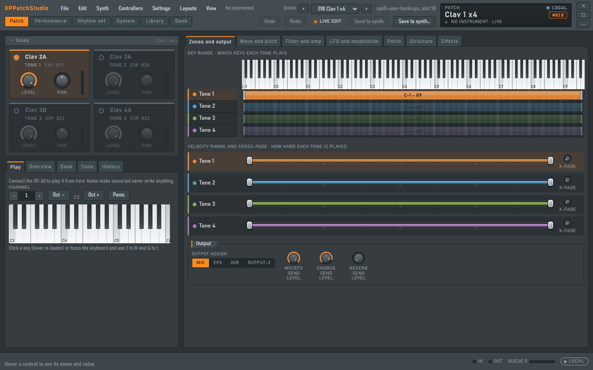
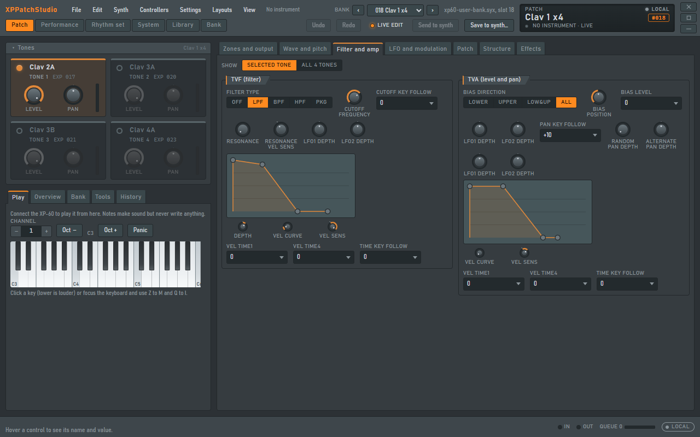
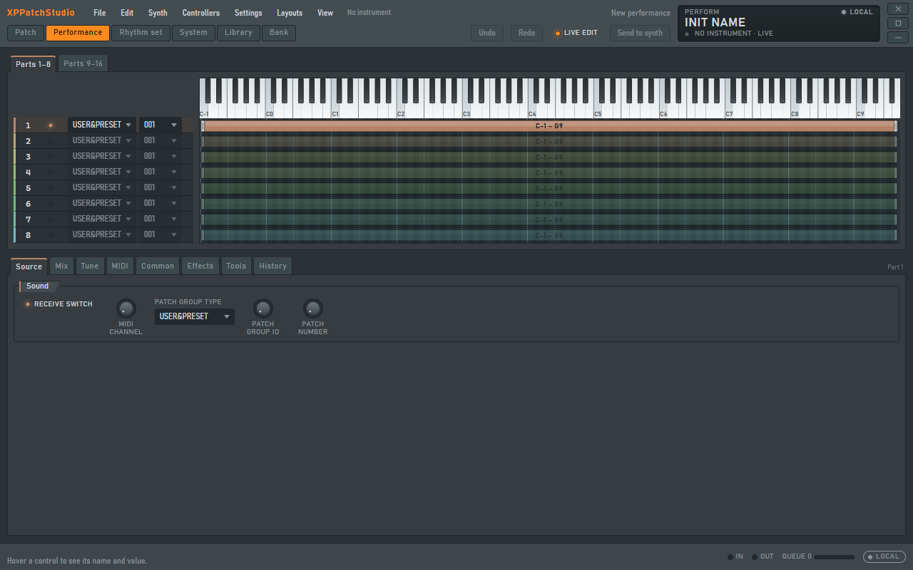
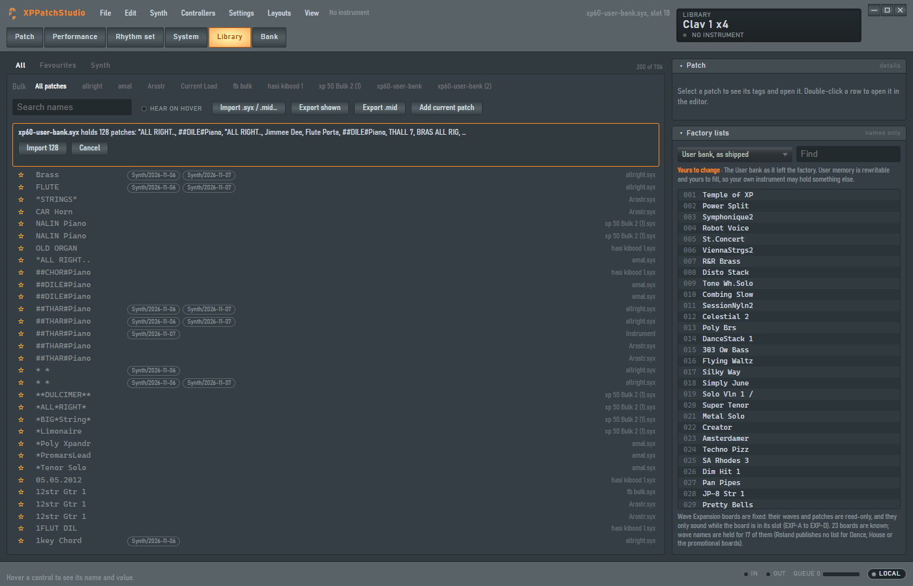
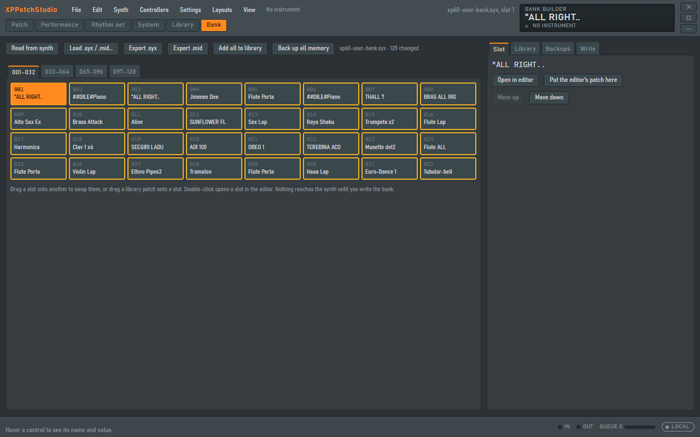
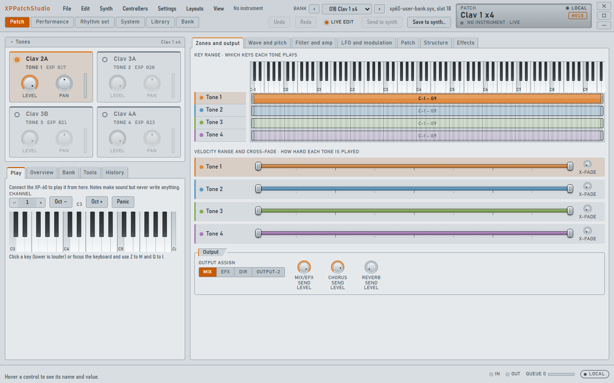

# XPPatchStudio

**A desktop patch editor and librarian for the Roland XP-60.**

Edit every parameter of a Patch, a Performance or a Rhythm Set with real knobs, ranges and envelopes. Keep thousands of sounds in a searchable library,
build 128-patch banks by drag and drop, and send the result to the instrument with a backup before and a read-back after. XPPatchStudio is a native
Windows and macOS desktop application: a Rust core talks to the XP-60 over MIDI, and a Tauri window draws the interface.

> **Status: built and tested without the instrument.** Everything runs and passes its tests against a virtual XP-60 and a real bank file. Nothing has
> been run against a physical XP-60 yet; that is one planned acceptance session (see [Roadmap](#roadmap)). Until a feature has been confirmed on the
> instrument it is labelled that way in the project's hardware ledger, and nothing is called done before then.



## Contents

[Features](#features) · [Interface conventions](#interface-conventions) · [Safety of your sounds](#safety-of-your-sounds) · [Install](#install) ·
[Running and building](#running-and-building) · [Architecture](#architecture) · [Quality](#quality) · [Roadmap](#roadmap) · [Documentation](#documentation)

## Features

### Patch editor

- **Four Tone cards** with an on/off dot, level, pan and a wave picker (the instrument's own waves, plus the Wave Expansion boards you mark as installed in Settings).
- **Seven tabs, grouped along the signal path**, each fitting the smallest window without a scroll bar:

  | Tab | What it holds |
  |---|---|
  | Zones and output | Key and velocity ranges of every Tone on a shared keyboard, and the selected Tone's output assignment and effect sends |
  | Wave and pitch | The sound source: wave, FXM and delay, then pitch with its envelope |
  | Filter and amp | The two stages that shape the sound, side by side, each with its envelope |
  | LFO and modulation | Both LFOs, then the controller routing |
  | Patch | Patch settings, play, portamento and the patch's controllers |
  | Structure | How Tones 1 and 2, and 3 and 4, are joined |
  | Effects | The effect, chorus and reverb |

  A **Selected Tone / All 4 Tones** switch on the three sound tabs lays the same section of all four Tones side by side.
- **Structure types** are drawn as wiring diagrams (wave generator, filter, amplifier, booster and ring modulator) with a description of what each type does; the
  booster is only live where the manual says it applies.
- **Effects** are named: all 40 EFX types list their own parameters. Controller destinations read as words (Pitch, Cutoff, Pitch LFO1 and so on).
- **Envelopes are drawn and dragged, not typed.** Undo and redo with a browsable history, A/B compare, copy and paste of Tones and sections, init, randomize,
  mutate and morph.
- **Files and banks.** Open a `.syx` or `.mid` bank, step through its patches with previous and next, or pick one from the Bank list. Export what is open (a
  patch, Performance, Rhythm Set or the System settings) as `.syx` or `.mid` from the File menu.



### Performance and Rhythm Set editors

Sixteen Parts on two tabs, each with its key range on a shared keyboard and its Patch chosen in the same row, with Common, Effects, MIDI and per-Part tabs
underneath. Rhythm Sets edit key by key on a vertical roll. Whole-memory `.syx` backups open here too: all 32 Performances and both Rhythm Sets of a backup are
listed in the header picker.



### System settings and scale tuning

- **System** pages for sound mode, control sources, MIDI receive and transmit, pedals, bank select, preview and arpeggio.
- **Scale tune** has a large knob for each of the twelve notes with its value in cents readable on the knob, over a keyboard drawing. Choose Patch mode or any of the
  16 Performance Parts, start from Equal, Pure (tonic C) or Arabian (the manual's own example scales), and copy a scale between Parts. A switch on the page turns the
  scale on or off.
- **Writing System settings** to the instrument follows the same steps as saving a patch: read and back up, confirm, write, read back, with an undo.

### Librarian

An on-disk SQLite library with search, tags, favourites and folders; import and export of `.syx` and standard `.mid` files; find and replace across names; browsable
factory patch lists; "hear on hover" through the instrument's temporary memory; and automatic backups before every write.



### Bank builder

A 128-slot grid: drag slots to swap, drag library patches onto slots, load a bank from the instrument or a file, export it, and write it back. Nothing reaches the
instrument until you arm and confirm a write.



### Made for a desktop

Its own title bar and window controls, a status readout in the top bar that follows the pointer (it shows the value of the control you hover, as the hardware shows
the parameter you touch), a hint bar, native Save dialogs, drag and drop of files anywhere in the window, MIDI controller learn (including NRPN and RPN), an editable
shortcut map, saved window layouts, and a dark theme with a light alternative.



## Interface conventions

These rules apply to every screen and are checked by automated tests where a test can check them.

- **A desktop application, not a web page.** Designed and tested as a native Windows and macOS program: native window, native dialogs, direct MIDI. The smallest
  supported window is 1100 by 700.
- **Every message appears in the bottom-left corner, and nowhere else.** Errors, warnings, information, confirmations and validation problems stack above the hint
  bar with a kind tag (Error, Warning, Info, Done), can be dismissed, and clear themselves (information after 5 seconds, errors after 20). No message line is drawn in
  the top bar, in a panel or on a page, and messages never show folder paths, only file names. A test fails if a new message line appears elsewhere.
- **No box, ring or border around a control.** A knob, slider, switch or stepper shows keyboard focus by the control itself lighting up; buttons, tabs and menus show
  it with a soft tint laid over them; selected items are tinted, never outlined. An end-to-end check focuses controls on every editor page and fails on any added
  shadow, outline, fill or border.
- **Tabs merge by what belongs together.** Tabs follow the signal path and never mix pages that follow the selected Tone with pages that apply to the whole patch.
  Every Patch tab fits the smallest window without a scroll bar; an end-to-end check enforces it.
- **No unexplained empty space.** Groups are packed in columns so a short group does not leave a hole beside a tall one, and wide frames place controls beside their
  graphs. Content that cannot fit scrolls inside its own area; nothing is cut off.
- **Fixed and yours are labelled.** Preset memory and expansion boards are read-only; User memory and System settings are yours (see below).

## Safety of your sounds

Writing to the instrument is a deliberate act, never a side effect of editing.

- **Temporary and permanent memory are different operations.** Live edit and hover audition use the instrument's temporary area and never touch User memory.
- **Writes to User memory and to the System settings are armed and confirmed.** The destination is chosen by you, what it overwrites is read and saved to a backup
  file first (and the file is read back to prove it holds what was read), the write is paced and confined to the intended memory region, the result is read back and
  compared, and the previous contents can be put back. One arming allows exactly one write.
- **Fixed and yours are kept apart.** The XP-60's Preset patches and any installed Wave Expansion board are read-only memory, the same on every instrument, and the
  app never writes to them (you edit a copy and save it to User memory). User memory and System settings are yours; the factory list of the User bank is shown only as
  "as shipped" and is never presented as what your instrument holds.
- **The state of a sound is always shown in words and colour:** LOCAL, EDITED, SENT, TEMP VERIFIED, STALE, SAVED or MISMATCH.
- **Damaged or truncated files are errors with a position**, never silently shortened.

## Install

Download `XPPatchStudio_<version>_x64-setup.exe` from the [latest release](../../releases/latest) and run it. The setup walks through the usual steps: welcome, install
for all users or just you, the folder to install into (the default is offered and you can browse to another), a Start menu folder, then Finish. The app appears in the
Start menu and under *Settings > Apps*, where it can be uninstalled; uninstalling asks whether to delete your library and backups, and keeps them unless you tick the box.
Windows 10 and 11 only; if the Microsoft WebView2 runtime is missing the setup installs it. The installer is not code-signed yet, so Windows SmartScreen may warn the
first time: choose *More info > Run anyway*.

## Running and building

You need Windows 10 or 11 (the platform it is developed and tested on) or macOS, an XP-60 and a MIDI interface. The app also works without an instrument: you can edit,
organise and export files offline.

**On Windows, double-click `XPPatchStudio.bat`** and choose:

1. **Run** starts the app, building it first if it has never been built.
2. **Build and run** rebuilds from the latest source, then starts the app.
3. **Publish** builds the Windows installer and can then put it on a GitHub release (it checks that everything is committed and pushed, and asks before publishing).

**From the command line:**

```bash
rustup target add wasm32-unknown-unknown
cargo install wasm-bindgen-cli --version 0.2.130 --locked
cd ui && npm install && npm run wasm && npm run build && cd ..
cargo build -p xppatch-app --release --features custom-protocol
```

`npm run installer` (in `ui/`) builds the installer on its own into `target/release/bundle/nsis/`.

**Releasing (maintainers):** raise `version` in `Cargo.toml` and `crates/xppatch-app/tauri.conf.json`, then `git tag vX.Y.Z && git push origin vX.Y.Z`. The *Release*
workflow runs the interface tests, builds the installer and attaches it to a GitHub release.

## Architecture

```
XP-60  <--MIDI SysEx-->  midir  -->  xppatch-midi  -->  xppatch-app (Tauri commands)  -->  Svelte UI
                                         |                                                     |
                              xppatch-sysex, xppatch-core  <-- the same codec, as WebAssembly -+
```

| Path | What it is |
|---|---|
| `data/xp60-parameters.json` | The single source of truth: every parameter's address, size, encoding, range and display text. The editor controls and the SysEx addressing are both generated from it; nothing is copied by hand between them. |
| `data/efx-parameters.json` | The names and raw ranges of the twelve parameters of each of the 40 EFX types, built by `scripts/build_efx_data.py`. |
| `data/factory/xp60-factory.json` | The instrument's own reference lists, built by `scripts/build_factory_data.py` from Roland's published documents: 640 factory patch names, 448 internal wave names, the 23 SR-JV80 expansion boards and the wave names of the 17 boards Roland publishes lists for. Names only. |
| `crates/xppatch-sysex` | Roland addressing (7-bit carry), checksum, RQ1/DT1 messages, chunking, and the memory map that tells temporary memory from User memory. |
| `crates/xppatch-core` | The parameter map, the block and patch codec, `.syx` and `.mid` files, display formatting, undo history, randomize, mutate and morph. No I/O. |
| `crates/xppatch-midi` | A `MidiTransport` trait with the real `midir` transport and a **virtual XP-60** that the whole stack is tested against, with injectable timeouts, retries and noise; the guarded write operations for patches, banks and System settings. |
| `crates/xppatch-library` | SQLite library: import and export, tags, folders, search, backups. |
| `crates/xppatch-wasm` | The codec compiled to WebAssembly, so the interface and the Rust side share one implementation. |
| `crates/xppatch-app` | The Tauri 2 desktop shell: windowing, MIDI commands, library and storage commands, native Save dialogs. |
| `ui/` | Svelte 5 and TypeScript: the control kit (knobs, sliders, envelopes, key map, message stack, readout), the editors and the views. |

**Protocol facts the code is built on.** Messages are Roland DT1 (data set) and RQ1 (data request) with a checksum over address and data. The Patch temporary area is at
`03 00 00 00`, User patch memory at `11 nn 00 00`, User Performances and Rhythm Sets under `10`, and the System settings at `00 00 00 00`. At most 128 data bytes are sent
per message with at least a 20 ms gap, and one request is outstanding at a time. Each of these is recorded with its source, and anything not yet verified is recorded as
unknown rather than guessed. The order of authority is the official Roland manual, then verified hardware captures, then supplied known-good files, then experiments on
the instrument.

## Quality

`unsafe` code is forbidden across the workspace. The codec is checked by golden-file tests against a real XP-60 bank (every parameter round-trips), property tests and
malformed-input tests. The interface has model tests, component tests for the controls and several panels, and an end-to-end check that drives the built desktop app
(open a bank, step through it, edit, export and re-open byte for byte, open Performances and Rhythm Sets, preview an import, open the save panels, check where messages
appear, tab through every control for focus rings, and confirm that no tab scrolls and no layout is clipped at two window sizes).

```bash
cargo test --workspace
cargo clippy --all-targets -- -D warnings
cd ui && npm test && npm run check
npm run coverage      # interface line coverage report
npm run e2e           # needs the release build of the app; uses no instrument and writes nothing outside a temporary folder
```

## Roadmap

| Phase | Scope | State |
|---|---|---|
| 0 | Reconnaissance and written specification | Done |
| 1 | Core, SysEx codec, checksum, golden tests | Done |
| 2 | MIDI transport, fetch and send with timeouts and retries | Done (virtual XP-60) |
| 3 | Control kit, theme, storybook | Done |
| 4 | Patch editor, hint bar, undo, live edit | Done, awaiting instrument |
| 5 | Performance and Rhythm Set editors | Done, awaiting instrument |
| 6 | Librarian, backups and the save ceremony | Done, awaiting instrument |
| 7 | Compare, init, randomize, mutate, morph, copy and paste | Done |
| 8 | Parity audit of every planned feature | Done: 63 rows, 26 done, 33 built and waiting for the instrument, 1 partial (free docking), 3 proposed won't-do |
| 9 | **Hardware acceptance**: one session on a physical XP-60 | **Next** |

After hardware acceptance:

- Free docking and floating windows (the workspaces are tabbed today; named layouts can be saved).
- Library storage for Performances and Rhythm Sets (the library holds patches; the others can be exported and opened as files).
- Further hardware findings from the acceptance session folded back into the parameter map.
- Other XP and JV models, only after the XP-60 is proven.

## Documentation

Plans, the feature catalogue, the protocol notes, the parity matrix and the hardware acceptance ledger are in [`artifact/docs/xppatchstudio/`](artifact/docs/xppatchstudio/).
The change history is in [`CHANGELOG.md`](CHANGELOG.md).

## Licence and trademarks

All rights reserved for now; a licence will be chosen before a public release. Roland and XP-60 are trademarks of Roland Corporation. XPPatchStudio is an independent
project and is not affiliated with or endorsed by Roland. FL Studio is a trademark of Image-Line; only its design language was used as a reference. The interface follows
that design language, reinterpreted rather than copied: graphite surfaces, a single warm accent, small-caps labels, drag-to-set controls with fine adjustment, and controls
drawn from scratch as vector graphics; no third-party assets, icons or fonts are bundled.
